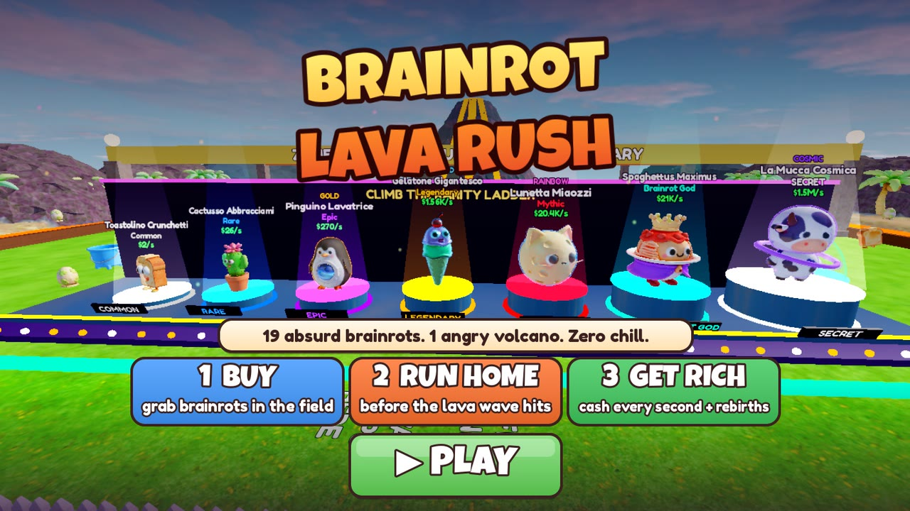

# Brainrot Lava Rush

A 3D Roblox brainrot game, built for make.fun's "Make the best AI Roblox brainrot game" bounty (roblox-brainrot-01).

## The loop

1. **Buy.** Wild brainrots wander a four-zone field that runs north to a volcano: Snack Meadow, Goober Gulch, Chaos
   Canyon and Volcano Rim. Rarer ones live closer to the volcano. Hold **E** to buy one.
2. **Run home.** It rides over your head and a beam points to your base. Every 45 seconds a lava wave pours off the
   volcano and sweeps the field. Get home or into a safe dome, or you're wiped out and drop your catch. Wild
   brainrots the lava washes over can turn into **Lava** mutations (x4 cash).
3. **Get rich.** At home it lands on a pad and pays cash every second. Sell with **F**, upgrade speed with **U** and
   rebirth for +50% cash forever plus another pad.

**Threats.** Other players can steal from your pads. Furbetto the Snack Bandit, an NPC thief, raids a base every 70
seconds and runs off with your best brainrot. The **base lock** (the red button, or **L**) puts laser walls around
your base for 40 seconds.

**The bonk bat.** Everyone spawns with one (press **1**, click to swing). Bonk Furbetto and he spins away and vanishes
in a puff, dropping the loot and paying a bounty. Bonk another player and they're knocked back and dizzy for a
moment; a stolen brainrot they carry flies home to its owner.

**Feel.** Brainrots and Furbetto waddle as they walk and breathe while idle, done procedurally on the client. A quiet
ukulele soundtrack from Roblox's licensed music library plays, with a mute button. The UI is a cartoon kit (`UiKit`).

**Events.** Golden Hour (4x mutation chance), Cash Frenzy (2x cash) and Meteor Shower (Mythic+ brainrots land near
home).

**The cast.** 19 original brainrots across 7 rarities, Common to SECRET, from Toastolino Crunchetti to Il Re dei
Calzini. Each one, and Furbetto, is a textured 3D model made for this game with Roblox's AI mesh generator. The
asset ids live in `BrainrotCatalog.MESHES`, and each brainrot falls back to a look built from parts if its mesh
can't load. There are 5 rolled mutations (Gold x2, Diamond x3, Rainbow x6, Cosmic x10, plus Lava from the wave). The
Brainrot Index (**B**) tracks the ones you've found.

## Layout

A Rojo project, built with `rojo build default.project.json --output game.rbxl`.

| Path | Job |
| --- | --- |
| `src/shared/BrainrotCatalog.luau` | rarities, mutations, the cast and their 3D looks |
| `src/shared/BrainrotModel.luau` | builds a brainrot model, paints mutations, labels |
| `src/shared/GameConfig.luau` | every tunable number, cost formulas, money formatting, the RemoteEvents |
| `src/server/init.server.luau` | boots the services, then runs the round clock: lava waves, thief raids, timed events, HUD requests |
| `src/server/ArenaBuilder.luau` | the map: bases, field, zones, volcano, domes |
| `src/server/PlayerState.luau` | all per-player state, saving, HUD snapshots |
| `src/server/BaseSlots.luau` | plots, pads, income per second, lock walls |
| `src/server/WildSpawner.luau` | wild brainrot spawning, wandering, buying |
| `src/server/CarryAndSteal.luau` | carrying home, stealing, the base lock |
| `src/server/LavaWave.luau` | the lava wave |
| `src/server/FurbettoThief.luau` | the NPC thief |
| `src/server/Progression.luau` | speed, rebirths, events |
| `src/server/BatService.luau` | the bonk bat, Furbetto hits, player knockback |
| `src/client/*.client.luau` | title screen, HUD and music, Brainrot Index, effects and knockback, walk animator |
| `src/client/UiKit.luau` | the shared cartoon UI pieces |

`src/shared` sits right in ReplicatedStorage, `src/server` is the `Server` script with its modules under it, and
`src/client` goes to StarterPlayerScripts.

`main.ts` hands the entry in: `mkdir -p out && MAKEFUN_OUTPUT_DIR=out node main.ts`.

The judge reads a 1,248-byte outline of the dossier: script headings first, then each script's function lines in
turn. So every script opens with the function that says most about its job, and the server script names the
round's clocks (`sendLavaWaves`, `sendThiefRaids`, `runTimedEvents`).
